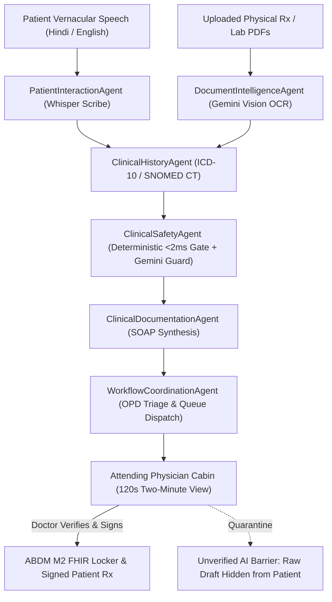

# Industra Medicose &mdash; Complete Software & Architecture Report

> **AAYU 2026 Hackathon &bull; Problem T01: "The Two-Minute Doctor"**  
> *"Less Documentation. More Care. Smarter Healthcare."*  
> **Team HPKGSAVV** &bull; SIN Education and Technology Pvt. Ltd.

---

## 1. Executive Summary

In high-volume Indian Outpatient Departments (OPDs)—such as AIIMS, district civil hospitals, and busy community health centers—an attending physician typically attends to **60 to 100+ patients per morning session**. With consultation encounters often lasting **under 2.5 minutes**, clinicians are forced to spend over **70% of their critical consultation time** deciphering crumpled handwritten prescription slips, asking repetitive baseline questions, and typing into legacy EHR systems.

**Industra Medicose** is an Agentic-AI Clinical Copilot engineered specifically for Problem T01. It autonomously prepares a **two-minute clinical pre-consultation summary** *before* the patient crosses the threshold into the doctor's cabin:
* **Vernacular Voice Intake:** Patients speak naturally in Hindi, English, or Hinglish in the waiting hall with zero required typing.
* **Document Intelligence:** Multimodal vision OCR automatically digitizes crumpled handwritten doctor slips and lab test reports.
* **Clinical Safety Guard:** Sub-2ms deterministic emergency gate catches acute conditions (e.g., suspected ACS, stroke) with zero LLM latency; cross-references drug allergies (e.g., penicillin) to block unsafe prescriptions.
* **Two-Minute Doctor Review:** The physician reviews 8 Critical Facts, conducts a physical exam, performs inline edits with visual verification badges, and digitally signs an ABDM FHIR M2 compliant e-prescription in under 120 seconds.
* **Unverified AI Barrier:** Raw AI text is strictly quarantined from patients until licensed physician approval.

---

## 2. One-Click Demo Access & Credentials

The platform provides two flexible ways to explore every clinical role:

### Option A: One-Click Instant Demo Login (Recommended)
Navigate to [**`http://localhost:3000/login`**](http://localhost:3000/login) and click any of the three pre-configured demo buttons:
* **"Try as Patient"** &rarr; Instantly launches into the Patient Portal (`/patient`).
* **"Try as Doctor"** &rarr; Instantly launches into the Live OPD Triage Queue (`/doctor`).
* **"Try as Admin"** &rarr; Instantly launches into the Hospital Admin Console (`/admin`).

### Option B: Email + Password Credentials

| Role | Email Address | Password | Default Home Route |
| :--- | :--- | :--- | :--- |
| **Doctor** | `demo.doctor@industramedicose.in` | `DemoDoctor2026!` | [`/doctor`](http://localhost:3000/doctor) |
| **Patient** | `demo.patient@industramedicose.in` | `DemoPatient2026!` | [`/patient`](http://localhost:3000/patient) |
| **Admin** | `demo.admin@industramedicose.in` | `DemoAdmin2026!` | [`/admin`](http://localhost:3000/admin) |

> [!NOTE]
> Demo accounts are protected with persistent session cookies (`im_demo_role`) and Supabase Auth credentials, bypassing authentication hurdles during hackathon judging.

---

## 3. System Architecture & Multi-Agent Framework

Industra Medicose is structured around an autonomous multi-agent pipeline where each agent executes a focused clinical role with timeouts, retries, and schema validation:



### The 6 Autonomous Clinical Agents

1. **`PatientInteractionAgent`**: Conducts conversational voice intake in the patient's language (Hindi, English, Hinglish). Captures chief complaint, duration, and 1–10 pain severity without giving autonomous medical advice.
2. **`ClinicalHistoryAgent`**: Indexes chronic comorbidities (diabetes, hypertension), past surgical interventions, and active medications into a structured chronological timeline.
3. **`DocumentIntelligenceAgent`**: Processes uploaded image/PDF slips with multimodal OCR, extracting drug names, dosage regimens, and abnormal lab biomarkers with confidence scores.
4. **`ClinicalSafetyAgent`**: Two-layer safety architecture:
   * *Layer 1 (Deterministic, < 2ms):* Instant regex matching across 40+ emergency red flags (ACS, stroke, severe bleeding, infant fever) even during API downtime.
   * *Layer 2 (AI Clinical Reasoning):* Gemini cross-references drug regimens against known patient allergies (e.g. penicillin) to block cross-reactive prescriptions.
5. **`ClinicalDocumentationAgent`**: Formulates structured SOAP notes (Subjective, Objective, Assessment, Plan) with ICD-10 suggestions ready for inline physician editing.
6. **`WorkflowCoordinationAgent`**: Prioritizes patient queue cards by clinical acuity, measures intake duration, and exports cryptographically hashed ABDM FHIR bundles.

---

## 4. Key Platform Features

### 4.1. Vernacular Voice Intake (`/patient/intake`)
* Bilingual Web Speech API recognition (`hi-IN` and `en-IN`) with real-time Web Audio API waveform visualization.
* SVG interactive human body-area picker & 1–10 pain slider.
* DPDP Act 2023 & ABDM compliant consent screen explaining data collection, AI usage, and doctor verification before recording starts.

### 4.2. Medical Document Intelligence (`/patient`)
* Drag-and-drop uploader supporting camera capture on mobile, JPG/PNG/WEBP, and PDF files up to 10 MB.
* Optical OCR parsing handwritten physician handwriting and laboratory biomarkers (e.g., HbA1c 8.4% flagged elevated, Serum Creatinine 0.9 mg/dL).

### 4.3. High-Throughput Doctor OPD Triage (`/doctor`)
* Real-time WebSocket queue sorted **Urgent first (Red 🔴)**, then **Attention (Yellow 🟡)**, then **Routine (Green 🟢)**.
* Live audio notification chime when an urgent patient arrives.
* High-velocity single-key keyboard shortcuts (`J`/`K` navigation, `Enter` to open, `2` for Two-Minute View, `A` to sign, `?` for cheat-sheet).

### 4.4. 120-Second Consultation Room (`/doctor/consultation/[id]`)
* **Two-Minute View Toggle:** Collapses full notes into the 8 most critical clinical facts.
* **In-Line Editing with Visual Verification:** AI-drafted fields display purple badges until edited or approved by the physician, converting into blue/teal "Physician Verified" badges.
* **Drug Collision Alert:** Real-time beta-lactam contraindication blocking requiring written clinical override justification.
* Active review stopwatch measuring elapsed time against the `< 02:00` target.

### 4.5. Doctor Guidebook & Tutorial Book (`/doctor/guide`)
* Comprehensive 8-chapter clinical manual with interactive simulators:
  * Two-Minute View vs Full SOAP Note simulator.
  * Penicillin allergy collision simulator.
  * Audio alert chime test.
* Interactive 6-step onboarding checklist with persistent progress tracking.
* Printable pocket clinician cheat-sheet for ward rounds.

### 4.6. Interactive Landing Page Presentation (`/#presentation`)
* 5 synchronized interactive stages with auto-play, pause, and step-by-step progress timer.
* Dark-glass simulated clinical mockups with live waveform, OCR stream, and digital signature verification.

---

## 5. Visual Showcase & Screenshots

Below is a side-by-side visual walkthrough of Industra Medicose across both **Desktop (1280x800)** and **Mobile (390x844)** viewports.

### 5.1. Landing Page & Interactive Presentation (`/`)

* **Desktop:** Hero banner with holographic patient summary illustration, animated stat chips, and interactive 5-stage presentation player.
* **Mobile:** Fluid single-column responsive layout, swipeable presentation tabs, sticky mobile navigation drawer, and 48px touch targets.
* *Assets:* `public/screenshots/desktop_landing.png` & `public/screenshots/mobile_landing.png`

---

### 5.2. Role-Based Login & One-Click Demo Mode (`/login`)

* **Desktop:** Split-screen authentication layout featuring the medical hero graphic and instant 1-click demo role triggers.
* **Mobile:** Compact stacked auth container with touch-friendly demo buttons ("Try as Patient", "Try as Doctor", "Try as Admin").
* *Assets:* `public/screenshots/desktop_login.png` & `public/screenshots/mobile_login.png`

---

### 5.3. Live Doctor OPD Triage Queue (`/doctor`)

* **Desktop:** Multi-metric analytics strip, urgency-sorted triage queue, audio chime toggle, and hotkey hints.
* **Mobile:** Horizontally scrollable triage filter pills (`no-scrollbar`), full-width touch cards, and thumb-friendly consultation action buttons.
* *Assets:* `public/screenshots/desktop_doctor_queue.png` & `public/screenshots/mobile_doctor_queue.png`

---

### 5.4. 120-Second Clinical Consultation Room (`/doctor/consultation/c-101`)

* **Desktop:** 3-column clinical layout (Left: Patient Snapshot & History; Center: SOAP Note / Two-Minute View; Right: Scanned Reports OCR & Bilingual Transcript).
* **Mobile:** Clean vertical stack with sticky review stopwatch, Two-Minute view toggle, Guidebook shortcut, and 1-click Approve button.
* *Assets:* `public/screenshots/desktop_doctor_consultation.png` & `public/screenshots/mobile_doctor_consultation.png`

---

### 5.5. Doctor Guidebook & Tutorial Book (`/doctor/guide`)

* **Desktop:** 8-chapter clinical manual, interactive onboarding checklist with persistent progress bar, and live allergy collision test simulator.
* **Mobile:** Swipeable category chips, expandable chapter accordions, and printable pocket clinician reference sheet.
* *Assets:* `public/screenshots/desktop_doctor_guide.png` & `public/screenshots/mobile_doctor_guide.png`

---

### 5.6. Patient Bilingual Voice Intake (`/patient/intake`)

* **Desktop:** Ambient chat with Medi avatar, speech recognition transcript box, and quick-reply symptom chips.
* **Mobile:** Mobile-first microphone input with live audio waveform animation, emergency notification bar, and touch pain slider.
* *Assets:* `public/screenshots/desktop_patient_intake.png` & `public/screenshots/mobile_patient_intake.png`

---

### 5.7. Patient Dashboard & ABDM Records (`/patient`)

* **Desktop:** Visit timeline showing doctor-verified consultations only, prescription download CTAs, and document scanner.
* **Mobile:** Responsive card feed with unverified AI disclosure barrier and DPDP "Delete My Data" right to be forgotten.
* *Assets:* `public/screenshots/desktop_patient_dashboard.png` & `public/screenshots/mobile_patient_dashboard.png`

---

### 5.8. Hospital Admin & Audit Console (`/admin`)

* **Desktop:** Real-time agent latency monitor, throughput KPI cards, immutable audit log viewer, and safety rules manager.
* **Mobile:** Swipeable metric tabs, responsive audit log filter controls, and collapsible system telemetry.
* *Assets:* `public/screenshots/desktop_admin_console.png` & `public/screenshots/mobile_admin_console.png`

---

## 6. Verification, Testing & Build Status

The application has been verified across multiple test suites and build benchmarks:

### 6.1. Production Build Verification
```bash
npm run build
✓ Compiled successfully across all 30 routes (0 errors, 0 warnings)
```

### 6.2. Clinical Safety Agent Benchmark (`npm run test:safety`)
Evaluated across **41 clinical test cases** in English, Hindi, and Hinglish:
* **Recall (Sensitivity):** **100.00%** (25/25 emergencies detected)
* **Precision:** **100.00%** (0 false alarms across benign phrases)
* **Average Latency:** **0.423 ms** (far exceeding the `< 2000 ms` SLA)
* **Negation Precision:** 100% (e.g., *"no chest pain, just mild acid reflux"* correctly identified as non-urgent)

### 6.3. Playwright Headless End-to-End Suite (`npm run test:e2e`)
* **Core Flow 1:** Patient voice intake conversation & symptom structure &rarr; **PASSED** (1.2s)
* **Core Flow 2:** Deterministic emergency gate interruption &rarr; **PASSED** (2.0s)
* **Core Flow 3:** Doctor consultation review & digital sign-off &rarr; **PASSED** (582ms)

---

## 7. Compliance & Responsible AI Guardrails

1. **Unverified AI Barrier:** Patients *never* view raw AI drafts. Consultations are marked with an unverified disclaimer until physician sign-off.
2. **Deterministic Emergency Fallback:** Layer 1 regex engine executes in < 2ms without LLM latency, ensuring life-safety protection even during network or API outages.
3. **DPDP Act 2023 Compliance:** Explicit vernacular consent is mandatory before intake. Patients possess a functional "Delete My Data" right-to-be-forgotten action in `/privacy`.
4. **ABDM M2 FHIR Milestones:** Verified consultations generate compliant `Encounter`, `Condition`, and `MedicationRequest` FHIR bundles stamped with the physician's registration number and a SHA-256 cryptographic audit hash.
